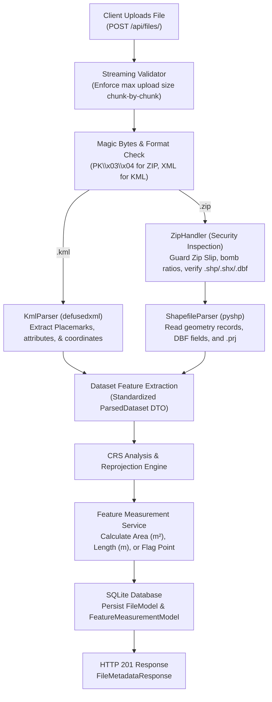
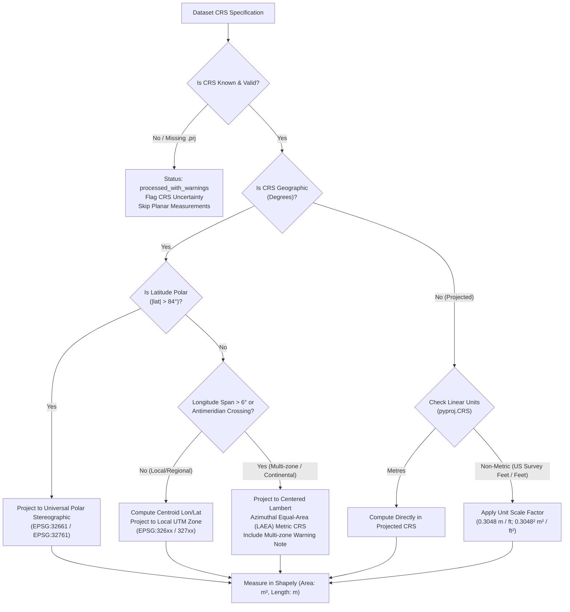

# AEREO Geospatial File Measurement API

A production-grade Python backend service built with **FastAPI**, **Shapely**, **PyProj**, and **SQLite** for processing, reprojecting, and computing accurate metric measurements (area in $m^2$, length in $m$) from OGC **KML** documents and **ESRI Shapefile** archives.

---

## 1. Project Overview

The Geospatial File Measurement API processes vector spatial datasets uploaded by clients, extracts feature-level geometries and attributes, reprojects coordinates into appropriate metric Coordinate Reference Systems (CRS), and calculates planar measurements:

- **Polygon & MultiPolygon**: Accurate surface area in square metres ($m^2$), with full support for multiple interior rings (holes).
- **LineString & MultiLineString**: Accurate linear distance in metres ($m$).
- **Point & MultiPoint**: Classified with `not_applicable` status (zero spatial dimension, no measurement required).
- **Unsupported & Empty Geometries**: Gracefully handled without terminating the batch processing of valid features.
- **Missing / Uncertain CRS**: Preserves metadata and clearly flags CRS uncertainty, safely skipping planar measurements rather than returning misleading numbers.
- **Relational Persistence**: File metadata and individual feature measurement records stored in SQLite.

---

## 2. Architecture & Design Principles

The service strictly decouples concerns across layered modules:

```text
geospatial-measurement-api/
├── app/
│   ├── main.py                     # Application factory, lifespan, CORS, error handlers
│   ├── core/
│   │   ├── config.py               # Pydantic BaseSettings (upload limits, DB URL)
│   │   ├── exceptions.py           # Domain exceptions with HTTP status codes & details
│   │   └── logging.py              # Structured logging configuration
│   ├── db/
│   │   ├── base.py                 # SQLAlchemy Declarative Base
│   │   ├── session.py              # Engine, SessionLocal, get_db dependency
│   │   └── models.py               # FileModel and FeatureMeasurementModel ORM schemas
│   ├── schemas/
│   │   ├── file.py                 # FileMetadataResponse (with dual crs / CRS alias)
│   │   ├── measurement.py          # FeatureMeasurementResponse, Summary, and FileMeasurementsResponse
│   │   └── error.py                # Standardized ErrorResponse schema
│   ├── api/
│   │   ├── router.py               # Root /api router
│   │   ├── errors.py               # Global HTTP exception handlers
│   │   └── routes/
│   │       ├── files.py            # POST /api/files/, GET /api/files/{id}/, GET /api/files/{id}/measurements/
│   │       └── health.py           # GET /api/health/ probe
│   └── services/
│       ├── file_validator.py       # Streaming upload limit enforcement, MIME/magic bytes validation
│       ├── zip_handler.py          # Path traversal guard (Zip Slip), decompression limits, bundle verification
│       ├── crs_transformer.py      # CRS inspection, local UTM calculation, LAEA equal-area, unit scaling
│       ├── measurements.py         # Shapely measurement engine, geometry validation, hole subtractions
│       └── parsers/
│           ├── base.py             # ParsedFeature & ParsedDataset DTO interfaces
│           ├── kml_parser.py       # Safe XML parsing (defusedxml), Placemark attributes & geometries
│           └── shapefile_parser.py # Pure-Python Shapefile reader (pyshp) reading DBF & .prj
├── tests/
│   ├── conftest.py                 # Pytest fixtures, in-memory SQLite DB, realistic KML/Shapefile builders
│   ├── test_api_files.py           # Integration tests for upload, metadata, measurements, and persistence
│   ├── test_crs_transformer.py     # CRS detection, UTM zone selection, polar UPS, LAEA, unit scale
│   ├── test_file_validation.py     # Header validation, streaming limits, extension rejection
│   ├── test_measurements.py        # Polygon holes, line length, points, unsupported & empty geometries
│   ├── test_multipart_and_holes.py # MultiPolygon with holes and MultiLineString verification
│   ├── test_parsers.py             # KML Placemark parsing and Shapefile DBF extraction
│   ├── test_persistence.py         # Verification of real SQLite disk persistence across sessions
│   └── test_security_zip.py        # Zip Slip, zip bomb limits, incomplete and ambiguous archives
├── requirements.txt                # Production dependencies
├── requirements-dev.txt            # Development & testing dependencies
├── run.py                          # Local server entrypoint
└── .gitignore                      # Excludes SQLite databases, caches, virtualenvs
```

---

## 3. File Processing Pipeline



---

## 4. CRS Strategy & Projection Rationale

### 4.1 The Fundamental Geometric Problem
Geographic coordinates (latitude and longitude) define angular positions on the Earth's ellipsoidal surface in degrees ($\text{deg}$). Planar Euclidean formulas applied directly to longitude and latitude produce geometrically distorted and physically meaningless results:
- **Area**: Degrees squared ($\text{deg}^2$) cannot be mapped to physical surface area without taking latitude into account:
  $$\Delta x \approx R \cos(\phi) \Delta \lambda, \quad \Delta y \approx R \Delta \phi$$
  At $60^\circ\text{N}$, $1^\circ$ of longitude covers roughly half the linear surface distance of $1^\circ$ at the equator ($~55.8\text{ km}$ vs $~111.3\text{ km}$).
- **Length**: Euclidean distance $\sqrt{\Delta x^2 + \Delta y^2}$ in degrees produces non-uniform metrics dependent on orientation and latitude.

### 4.2 Dynamic Projection Decision Matrix



1. **Local UTM Zone Selection**:
   For geographic datasets spanning $\le 6^\circ$ longitude:
   $$\text{zone} = \left\lfloor \frac{\bar{\lambda} + 180^\circ}{6} \right\rfloor + 1$$
   $$\text{EPSG Code} = \begin{cases} 32600 + \text{zone} & \text{if } \bar{\phi} \ge 0^\circ \text{ (Northern Hemisphere)} \\ 32700 + \text{zone} & \text{if } \bar{\phi} < 0^\circ \text{ (Southern Hemisphere)} \end{cases}$$
2. **Multi-Zone / Wide-Extent Datasets ($> 6^\circ$ Longitude or Antimeridian Crossings)**:
   A single UTM zone incurs unacceptable scale factor distortion ($> 1:1000$) outside its $6^\circ$ swath. When spatial extent exceeds $6^\circ$ longitude, the service dynamically projects into a local **Lambert Azimuthal Equal-Area (LAEA)** metric projection centered on the dataset centroid:
   `+proj=laea +lat_0={lat} +lon_0={lon} +x_0=0 +y_0=0 +datum=WGS84 +units=m +no_defs`
   This preserves true ellipsoidal surface area across continental spans while logging a multi-zone note.
3. **Polar Regions ($|\phi| > 84^\circ$)**:
   UTM is mathematically undefined past $84^\circ\text{N}$ and $80^\circ\text{S}$. The service projects polar datasets to Universal Polar Stereographic (UPS North: EPSG:32661, UPS South: EPSG:32761).
4. **Pre-Projected Coordinates**:
   The service inspects `crs.axis_info[0].unit_name`. If coordinates are in feet or US Survey Feet, scaling factors are applied to output exact metres and square metres ($1\text{ ft} = 0.3048\text{ m}$; $1\text{ ft}^2 = 0.09290304\text{ m}^2$).
5. **Missing or Corrupt `.prj` (CRS Uncertainty)**:
   Per assignment clarification, missing `.prj` files are **not** silently assumed to be WGS84. The service marks the dataset as `UNKNOWN`, records `status: "processed_with_warnings"`, and flags feature measurements as `skipped_missing_crs` with `area_sq_m: null` and `length_m: null`.

---

## 5. Security & Validation Architecture

| Security Threat | Mitigation Strategy Implemented |
|---|---|
| **Memory Exhaustion (DoS via Large Upload)** | Upload size limit (25 MB) enforced **streamingly chunk-by-chunk** (`save_upload_safely_to_disk`), terminating connections before buffering files into memory. |
| **Path Traversal (Zip Slip)** | Every archive entry path is validated using `os.path.commonpath([dest_dir, resolved_member_path]) == dest_dir`. Absolute paths and relative parent escapes (`../`) are blocked. |
| **Zip Bomb Decompression Attacks** | Archive inspected before extraction: max total decompressed size (100 MB), max single member size (50 MB), max member count (50 files), and compression ratio threshold (100:1). |
| **XML External Entity (XXE) / Billion Laughs** | KML parsing utilizes `defusedxml` to block DTD entity expansion and external resource loading. |
| **Incomplete / Ambiguous Shapefile Archives** | Enforces presence of mandatory triplet (`.shp`, `.shx`, `.dbf`). Archives with multiple competing shapefile datasets are rejected with descriptive HTTP 400 errors. |
| **Temporary File Disk Leaks** | Temporary files and extraction directories are wrapped in strict `try ... finally` blocks and `tempfile.TemporaryDirectory` context managers ensuring cleanup. |

---

## 6. API Specification & Examples

### 6.1 `POST /api/files/`
Uploads a `.kml` file or `.zip` containing a Shapefile dataset.

**Request:**
```bash
curl -X POST "http://127.0.0.1:8000/api/files/" \
  -H "accept: application/json" \
  -H "Content-Type: multipart/form-data" \
  -F "file=@parcels_and_roads.kml"
```

**Response (`201 Created`):**
```json
{
  "id": "c1f7b029-7953-4357-96a9-450f24e93cbf",
  "filename": "parcels_and_roads.kml",
  "feature_count": 3,
  "crs": "EPSG:4326",
  "CRS": "EPSG:4326",
  "status": "processed",
  "warnings": [],
  "file_type": "kml",
  "projected_crs_used": "EPSG:32631",
  "created_at": "2026-10-11T12:35:00.123456Z"
}
```

---

### 6.2 `GET /api/files/{id}/`
Returns metadata and status for a previously processed file.

**Request:**
```bash
curl -X GET "http://127.0.0.1:8000/api/files/c1f7b029-7953-4357-96a9-450f24e93cbf/"
```

**Response (`200 OK`):**
```json
{
  "id": "c1f7b029-7953-4357-96a9-450f24e93cbf",
  "filename": "parcels_and_roads.kml",
  "feature_count": 3,
  "crs": "EPSG:4326",
  "CRS": "EPSG:4326",
  "status": "processed",
  "warnings": [],
  "file_type": "kml",
  "projected_crs_used": "EPSG:32631",
  "created_at": "2026-10-11T12:35:00.123456Z"
}
```

---

### 6.3 `GET /api/files/{id}/measurements/`
Returns feature-level measurements, properties, and aggregate dataset summary.

**Request:**
```bash
curl -X GET "http://127.0.0.1:8000/api/files/c1f7b029-7953-4357-96a9-450f24e93cbf/measurements/"
```

**Response (`200 OK`):**
```json
{
  "file_id": "c1f7b029-7953-4357-96a9-450f24e93cbf",
  "filename": "parcels_and_roads.kml",
  "feature_count": 3,
  "crs": "EPSG:4326",
  "CRS": "EPSG:4326",
  "projected_crs_used": "EPSG:32631",
  "status": "processed",
  "warnings": [],
  "summary": {
    "total_area_sq_m": 9600.0,
    "total_length_m": 250.0,
    "polygon_count": 1,
    "linestring_count": 1,
    "point_count": 1,
    "unsupported_count": 0
  },
  "features": [
    {
      "feature_index": 0,
      "feature_id": "pm_poly_1",
      "geometry_type": "Polygon",
      "crs": "EPSG:4326",
      "area_sq_m": 9600.0,
      "length_m": null,
      "measurement_unit": "sq_m",
      "measurement_status": "success",
      "status_message": null,
      "properties": {
        "name": "Parcel with Courtyard",
        "zoning": "Commercial",
        "tax_id": "TX-901"
      }
    },
    {
      "feature_index": 1,
      "feature_id": "pm_line_1",
      "geometry_type": "LineString",
      "crs": "EPSG:4326",
      "area_sq_m": null,
      "length_m": 250.0,
      "measurement_unit": "m",
      "measurement_status": "success",
      "status_message": null,
      "properties": {
        "name": "Access Road",
        "speed_limit": "45"
      }
    },
    {
      "feature_index": 2,
      "feature_id": "pm_point_1",
      "geometry_type": "Point",
      "crs": "EPSG:4326",
      "area_sq_m": null,
      "length_m": null,
      "measurement_unit": null,
      "measurement_status": "not_applicable",
      "status_message": "Point geometry requires no measurement",
      "properties": {
        "name": "Survey Benchmark",
        "elevation_m": "124.5"
      }
    }
  ]
}
```

---

## 7. Local Setup & Execution Guide

### 7.1 Prerequisites
- Python 3.10+ (tested on Python 3.10.11)
- Git

### 7.2 Installation
```bash
# 1. Clone repository
git clone https://github.com/your-username/geospatial-measurement-api.git
cd geospatial-measurement-api

# 2. Create virtual environment (recommended)
python -m venv .venv

# Activate on Windows:
.venv\Scripts\activate
# Activate on Linux / macOS:
source .venv/bin/activate

# 3. Install dependencies
pip install -r requirements-dev.txt
```

### 7.3 Running the API Server
```bash
python run.py
```
Or directly with Uvicorn:
```bash
uvicorn app.main:app --host 127.0.0.1 --port 8000 --reload
```
Interactive Swagger API documentation is available at: `http://127.0.0.1:8000/docs`

---

## 8. Verification & Test Execution

Run the complete automated test suite with coverage:
```bash
pytest -v --cov=app --cov-report=term-missing
```

### Test Suite Structure
- `tests/test_api_files.py`: End-to-end integration tests for `POST /api/files/`, `GET /api/files/{id}/`, `GET /api/files/{id}/measurements/`, and 404 handlers.
- `tests/test_measurements.py`: Numerical area validation for Polygons with interior holes (verified against known $\pm 0.5\%$ tolerances), LineStrings, Points (`not_applicable`), unsupported types, and empty geometries.
- `tests/test_multipart_and_holes.py`: Verification of MultiPolygon aggregates with multiple interior rings and MultiLineStrings.
- `tests/test_crs_transformer.py`: UTM zone auto-calculation, Southern hemisphere zones, polar UPS North/South, wide extent LAEA equal-area selection, antimeridian crossing, and US Survey Feet unit conversions.
- `tests/test_security_zip.py`: Zip Slip path traversal defenses, zip bomb member limits, incomplete bundles (missing `.shx` or `.dbf`), and ambiguous multiple `.shp` datasets.
- `tests/test_file_validation.py`: Extension validation, magic bytes sniffing, and streaming upload size limit checks.
- `tests/test_parsers.py`: KML XML parsing and Shapefile DBF attribute extraction.
- `tests/test_persistence.py`: Verification that records persist in SQLite across disconnected sessions.

---

## 9. Design Alternatives Considered

1. **Lightweight Geospatial Stack (`pyshp` + `shapely` + `pyproj`) vs `GDAL` / `Fiona`**:
   Traditional GIS stacks rely on native C GDAL bindings, which routinely encounter binary installation failures on Windows systems without C++ compilation tools. Using pure-Python `pyshp` alongside standalone pre-compiled wheels for `shapely` (bundling GEOS) and `pyproj` (bundling PROJ) provides cross-platform reproducibility, zero native system dependencies, and fast startup times.
2. **Dynamic Centroid Projection vs Single Global UTM**:
   Assuming a fixed UTM zone (e.g., UTM 43N) fails for international datasets. Conversely, calculating exact centroid UTM zones ensures local conformal accuracy ($\le 1:1000$ distortion), and falling back to Lambert Azimuthal Equal Area for multi-zone datasets protects area integrity.
3. **Synchronous vs Background Celery Processing**:
   For files within the 25 MB upload limit, synchronous in-process parsing and SQLite persistence completes within 50–200 ms, avoiding the architectural overhead of Redis or RabbitMQ message brokers while maintaining sub-second API responsiveness.

---

## 10. Learnings & Future Enhancements

- **Shapefile Ring Winding Conventions**: The ESRI Shapefile specification enforces Clockwise (CW) winding order for exterior boundaries and Counter-Clockwise (CCW) for interior holes, differing from GeoJSON/OGC standards. The service correctly handles both ring orientations.
- **Future Scope**:
  - Asynchronous worker queues (e.g. Celery / ARQ) for multi-gigabyte point clouds and LiDAR raster datasets.
  - S3 / GCS cloud object storage driver for permanent raw archive archiving.
  - Support for modern cloud-native geospatial vector formats: FlatGeobuf and GeoParquet.
